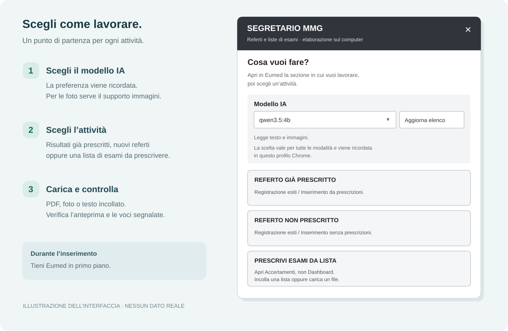

  

  Un assistente per i medici che usano <strong>Eumed</strong>. 
  Legge referti e liste di esami e ti aiuta a compilare il gestionale, sotto il tuo controllo.

  <a href="https://github.com/1702micky/segretariommg/releases/download/v0.16.1/SegretarioMMG-Setup-0.16.1.exe"><strong>↓ Scarica per Windows</strong></a>
  &nbsp; · &nbsp;
  <a href="#inizia-in-quattro-passaggi">Come si installa</a>
  &nbsp; · &nbsp;
  <a href="#domande-frequenti">Domande frequenti</a>

Windows 64 bit · Google Chrome · IA sul tuo computer

> **Versione pilota 0.16.1.** Prima dell’uso abituale, prova il programma e controlla i risultati in Eumed. Il programma di installazione non è ancora firmato digitalmente.

## Cosa puoi fare

| Se vuoi… | Scegli questa modalità |
|---|---|
| Inserire i risultati di esami già presenti nel gestionale | **Referto già prescritto** — compila le righe esistenti. |
| Registrare un referto senza una prescrizione pregressa | **Referto non prescritto** — crea le righe per gli esami riconosciuti. |
| Preparare una prescrizione da un elenco | **Prescrivi esami da lista** — legge testo, PDF e foto, anche con X e spunte. |

Puoi incollare il testo o caricare un **PDF, un JPEG o un PNG**. Gli esami vengono confrontati con il catalogo di laboratorio; le voci non associate con certezza vengono segnalate per la verifica.

## Uno sguardo al programma

*Anteprima illustrativa ricostruita dai testi dell’interfaccia attuale. Non contiene dati di pazienti e non è uno screenshot della pagina Eumed.*

### Dal documento al gestionale

**1. Scegli l’attività** → **2. Carica o incolla il documento** → **3. Analizza e verifica** → **4. Inserisci in Eumed**

Gli esami semplici possono essere inseriti come valori numerici; quelli composti, come emocromo e urine, vengono gestiti come referti estesi. Per i documenti difficili puoi usare la lettura con IA.

**Controlla sempre l’anteprima, le voci segnalate e il risultato finale.** Durante l’inserimento tieni Eumed in primo piano e non lavorare contemporaneamente sugli stessi campi.

## Inizia in quattro passaggi

### 1 · Scarica e avvia il setup

[**Scarica Segretario MMG per Windows**](https://github.com/1702micky/segretariommg/releases/download/v0.16.1/SegretarioMMG-Setup-0.16.1.exe)

Chiudi completamente Chrome e gli eventuali lavori IA in corso. Avvia il file e autorizza la richiesta di Windows. Usa lo stesso account amministratore con cui lavori in Chrome.

Il programma viene installato in **`C:\AI\segretario-mmg-extension`**: mantieni questa cartella nello stesso posto.

### 2 · Scegli il modello IA

Il setup mostra la RAM disponibile e propone un modello. Puoi cambiare la scelta:

| Computer | Modello proposto |
|---|---|
| Meno di circa 12 GB di RAM | **Qwen3-VL 2B**, più leggero |
| Da circa 12 GB di RAM | **Qwen3.5 4B**, il modello di riferimento del progetto |

La RAM è un’indicazione, non una garanzia di velocità. Servono Internet per i download e almeno **12 GB liberi su C:**. Il setup prepara Ollama, PDF e OCR e verifica i componenti; non devi installare Node o Python.

### 3 · Aggiungi l’estensione a Chrome

Al termine del setup segui queste istruzioni, necessarie **solo la prima volta**:

1. Digita **`chrome://extensions`** nella barra degli indirizzi di Chrome.
2. Attiva **Modalità sviluppatore**.
3. Premi **Carica estensione non pacchettizzata**.
4. Seleziona **`C:\AI\segretario-mmg-extension`**.

Se avevi una vecchia copia di Segretario MMG, disattivala prima di aggiungere questa: non lasciare due copie attive.

### 4 · Apri Eumed

Apri la sezione corretta, premi il pulsante **MMG** e scegli l’attività:

| Attività | Dove andare in Eumed |
|---|---|
| Referto già prescritto | **Registrazione esiti → Inserimento da prescrizioni** |
| Referto non prescritto | **Registrazione esiti → Inserimento senza prescrizioni** |
| Prescrivi esami da lista | **Accertamenti**, non Dashboard |

Nella schermata iniziale trovi anche il modello IA: puoi selezionare un altro modello già installato o premere **Aggiorna elenco**.

Per la prima prova usa una breve lista di esami e controlla l’anteprima prima di inserire i dati.

## Gli aggiornamenti

Se lasci attiva l’opzione del setup, il programma cerca nuove versioni all’accesso Windows e ogni ora. Gli aggiornamenti dell’estensione vengono applicati **soltanto quando Chrome è completamente chiuso**; altrimenti vengono rimandati.

Alla riapertura Chrome carica la versione aggiornata. Non devi scaricare manualmente lo ZIP di aggiornamento. Per controllare subito puoi usare il collegamento **Aggiorna-Segretario** creato sul desktop, dopo aver chiuso Chrome.

L’aggiornamento automatico riguarda l’estensione. Modelli IA, Ollama e programma di installazione hanno una gestione separata.

## Domande frequenti

<strong>I referti vengono inviati a un servizio IA online?</strong>

L’analisi IA usa Ollama e i modelli locali sul computer. L’estensione esclude i riferimenti ai modelli cloud. Il download dei componenti e il controllo degli aggiornamenti richiedono Internet; Eumed mantiene il proprio normale funzionamento online.

<strong>Devo pagare o avere un account sviluppatore Chrome?</strong>

Il pacchetto qui distribuito non richiede un account sviluppatore Chrome. L’estensione viene aggiunta manualmente dalla cartella locale, con la modalità sviluppatore attiva.

<strong>Posso usare un’altra IA?</strong>

Sì. Il selettore mostra i modelli locali presenti in Ollama e ricorda la scelta nel profilo Chrome. Per leggere foto e liste con spunte serve un modello che supporti anche le immagini. I modelli alternativi vanno provati: possono dare risultati e tempi diversi. Il ragionamento esteso è disattivato di default.

<strong>Il pannello dice che Ollama non risponde.</strong>

Avvia Ollama sul computer, poi premi **Aggiorna elenco** nella schermata iniziale. Se il problema continua, consulta il log del setup in `%LOCALAPPDATA%\SegretarioMMG`.

<strong>Un esame è segnalato come “da verificare”.</strong>

Non è stato associato o interpretato con sufficiente certezza. Controlla il documento originale e la voce del catalogo. Se l’inserimento si interrompe, controlla anche le righe già presenti prima di riprovare: non rilanciare automaticamente l’intero documento.

<strong>Come segnalo un problema?</strong>

Apri una [segnalazione su GitHub](https://github.com/1702micky/segretariommg/issues), indicando versione, modalità e passaggi per riprodurre il problema.

1. Nel pannello premi **Scarica report diagnostico (.txt)** e allega il file. È disponibile in tutte e tre le modalità dopo l’elaborazione e contiene tempi, conteggi e stato delle operazioni, senza copiare il testo del referto.
2. **Copia e incolla i dati anonimizzati del referto** utili a riprodurre l’errore: nome dell’esame, valore, unità e intervallo di riferimento, mantenendo le righe vicine quando servono a capire la struttura. Spiega cosa ti aspettavi e cosa è stato inserito.
3. Elimina prima nomi, codice fiscale, data di nascita, indirizzi, numeri di pratica e ogni altro elemento identificativo. Se non puoi anonimizzare con certezza, usa un esempio sintetico.

**Non allegare il PDF originale o schermate con dati personali.** Le segnalazioni di questo repository sono pubbliche. Controlla sempre anche il file diagnostico prima di condividerlo; non viene inviato automaticamente.

---

[Tutte le versioni](https://github.com/1702micky/segretariommg/releases) · [Guida completa al setup](installer/LEGGIMI-INSTALLER.md) · [Informazioni per sviluppatori](docs/SVILUPPO.md)
